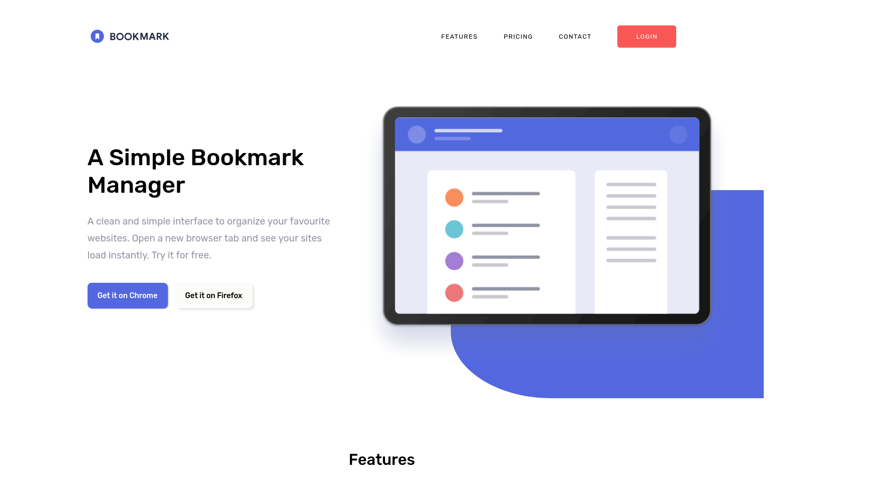

# Frontend Mentor - Bookmark landing page solution

This is a solution to the [Bookmark landing page challenge on Frontend Mentor](https://www.frontendmentor.io/challenges/bookmark-landing-page-5d0b588a9edda32581d29158). Frontend Mentor challenges help you improve your coding skills by building realistic projects. 

## Table of contents

- [Overview](#overview)
  - [The challenge](#the-challenge)
  - [Screenshot](#screenshot)
  - [Links](#links)
- [My process](#my-process)
  - [Built with](#built-with)
  - [What I learned](#what-i-learned)
  - [Continued development](#continued-development)
  - [Useful resources](#useful-resources)
- [Author](#author)

## Overview

### The challenge

Users should be able to:

- View the optimal layout for the site depending on their device's screen size
- See hover states for all interactive elements on the page
- Receive an error message when the newsletter form is submitted if:
  - The input field is empty
  - The email address is not formatted correctly

### Screenshot



### Links

- Solution URL: [Add solution URL here](https://your-solution-url.com)
- Live Site URL: [Add live site URL here](https://your-live-site-url.com)

## My process

### Built with

- Semantic HTML5 markup
- CSS custom properties
- Flexbox
- CSS Grid
- Mobile-first workflow
- Postcss

### What I learned

- Create the rounded blue background shape with code
```css
header.intro .intro--img-container::after {
  content: "";
  background-color: var(--soft-blue);
  position: absolute;
  z-index: -1;
  top: 23%;
  right: 0;
  width: 77.6vw;
  /*1,43349753695*/
  height: calc(77.6vw / 1.5);
  border-bottom-left-radius: 32%;
}
```

### Continued development

semantic html css javascript

### Useful resources

- https://www.w3schools.com
- https://developer.mozilla.org
- Kevin Powell on youtube

## Author

- Frontend Mentor - [@cornelisgijsbert](https://www.frontendmentor.io/profile/cornelisgijsbert)

